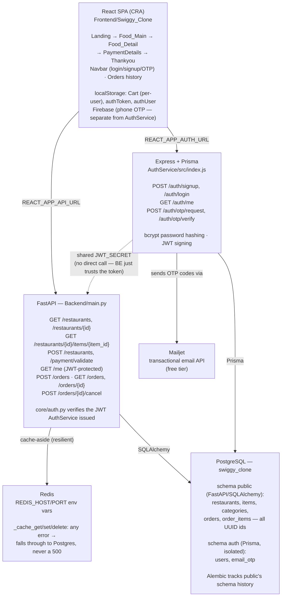

# Architecture

A Swiggy-style restaurant discovery demo: React frontend, a FastAPI backend
for restaurant/menu/order data, and a separate Express + Prisma service for
authentication — backed by one shared PostgreSQL database and Redis as an
optional cache.

## System diagram

## Components

### Frontend — `Frontend/Swiggy_Clone/`
React (CRA). `src/config.js` holds `API_BASE_URL` and `AUTH_BASE_URL`, both
overridable via `REACT_APP_API_URL`/`REACT_APP_AUTH_URL` env vars (baked in
at build time — CRA doesn't support runtime env vars). `utils/authApi.js`
wraps AuthService's endpoints and stores the JWT/user in `localStorage`.
Cart state is namespaced per signed-in user (`utils/cartKey.js`) so
switching accounts doesn't leak one user's cart into another's.

### Backend — `Backend/main.py`
FastAPI. Serves restaurant/menu data (public, no auth) and orders (requires
a JWT). Two things worth knowing if you're extending it:

- **UUID validation happens before any DB session opens** (`_parse_uuid`),
  so a malformed id in a URL or body gets a clean 422 without ever
  touching Postgres — see the function's docstring for why this isn't just
  `restaurant_id: uuid.UUID` as a path-param type.
- **Redis is a cache, not a hard dependency.** `_cache_get`/`_cache_set`/
  `_cache_delete` treat any Redis error as a cache miss / best-effort write
  and fall through to Postgres — a dead Redis degrades performance, not
  correctness.

### AuthService — `AuthService/`
Express + Prisma, deliberately separate from the FastAPI backend. Issues
JWTs (`jsonwebtoken`); FastAPI only *verifies* them (`Backend/core/auth.py`,
`PyJWT`) using a secret shared between the two services (`JWT_SECRET` in
each `.env`) — there's no synchronous network call between them at request
time. Its `User` model lives in a dedicated `auth` Postgres schema, isolated
from the tables FastAPI owns in `public`.

Two ways to authenticate:
1. **Email + password** — `POST /auth/signup`, `POST /auth/login`, bcrypt-hashed.
2. **Passwordless email OTP** — `POST /auth/otp/request` generates a code
   (stored in the `email_otp` table, 10-minute expiry) and emails it via
   **Mailjet's transactional API** (`src/lib/email.js`); `POST /auth/otp/verify`
   checks it and logs the user in. If `MAILJET_API_KEY`/`MAILJET_API_SECRET`
   aren't set, it falls back to logging the code to the console instead of
   failing, so the flow is developable without Mailjet configured.

(Firebase phone-OTP in the frontend is a separate, older auth path — not
connected to AuthService.)

### Database — PostgreSQL, `swiggy_clone`
One database, two schemas:
- `public` — owned by the FastAPI backend via SQLAlchemy: `restaurants`,
  `items`, `categories`, `orders`, `order_items`. Every primary key is a
  UUID (migrated in place from serial integers — see `Backend/migrations/README.md`
  for why raw `.sql` files exist there only as historical record).
  `items.category_id` drives day-gating (`categories.required_day`, e.g. a
  Wednesday-only special).
- `auth` — owned by AuthService via Prisma: `users`, `email_otp`. Fully
  isolated; FastAPI never queries it directly, only trusts its JWTs.

Schema changes go through **Alembic** (`Backend/alembic/`) on the FastAPI
side, and **`prisma db push`** (schema-sync, no migration files) on the
AuthService side.

### Cache — Redis
Used two ways in the codebase: `Backend/main.py` opens its own client
directly for the endpoints above, and for `RateLimitMiddleware`/
`TimingMiddleware` (`Backend/middleware/rate_limit.py`, registered in
`main.py`, ordered so CORS wraps around rate limiting — otherwise a 429
would be missing CORS headers and the browser would report it as a CORS
failure instead); `Backend/core/redis_client.py` + `core/cache.py` provide
a separate connection-pooled client and a `@cached(...)` decorator that no
endpoint currently uses. All Redis-dependent code treats a Redis error as
"degrade, don't fail" — caching falls through to Postgres, rate limiting
fails open — so a dead Redis costs performance/enforcement, never
correctness. Both clients read `REDIS_HOST`/`REDIS_PORT` from the
environment (defaulting to `localhost`), which is what makes them work
inside Docker/Render without code changes.

## Deployment

Dockerfiles exist for all three services (`Backend/Dockerfile`,
`AuthService/Dockerfile`, `Frontend/Swiggy_Clone/Dockerfile` — the last is a
multi-stage build served by nginx with SPA fallback, so a direct URL like
`/food/<uuid>` doesn't 404). `docker-compose.yml` orchestrates all five
pieces (the three services + Postgres + Redis) for local use.
`Backend/docker-entrypoint.py` creates the schema and seeds demo data
automatically the first time it runs against an empty database — Alembic's
own revision history has no from-scratch migration (it starts mid-history,
assuming the schema already exists), so this covers that gap for a fresh
deploy target.

For a public URL: `render.yaml` is a Render Blueprint deploying backend,
authservice, frontend, and a free Redis instance in one shot. It expects an
external Postgres (Neon recommended over Render's own free tier, which
expires after 30 days) and doesn't yet include Mailjet's env vars — add
`MAILJET_API_KEY`/`MAILJET_API_SECRET`/`MAILJET_SENDER_EMAIL` to
`authservice` there before relying on OTP email in production. Full
step-by-step in `DEPLOY.md`.

## Known gaps

- `core/cache.py`'s `@cached(...)` decorator isn't used anywhere; `main.py`
  has its own separate inline caching instead.
- `render.yaml` doesn't yet include Mailjet's env vars for `authservice` —
  add `MAILJET_API_KEY`/`MAILJET_API_SECRET`/`MAILJET_SENDER_EMAIL` there
  before relying on OTP email once actually deployed.
- The repo's git remote is Azure DevOps; a GitHub mirror exists solely
  because Render's Blueprint deploy requires GitHub/GitLab/Bitbucket.
- No automated tests for AuthService or the frontend yet — Backend has a
  pytest suite (`Backend/tests/`, run in CI); the manual path (sign
  up/log in, browse, order) is still how the other two get exercised.
